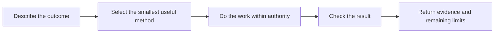

# agent-plugins

Practical methods for AI-assisted work: diagnose a bug, plan a change, research a
claim or hand work over with evidence someone else can use.

Start with the task. You can ask for a method explicitly and inspect how it
works when you need more control. Shared scope, authority and evidence rules
have one owner; a plugin supplies the detailed method.

**[Try a five-minute first task](docs/getting-started.md)** ·
[Choose by need](#choose-by-need) · [See real walkthroughs](docs/guides/README.md)

## Try it

In Claude Code, add the marketplace and install one method:

```text
/plugin marketplace add JRichlen/agent-plugins
/plugin install find-before-build@jrichlen
```

Ask: “Before adding another gallery capture helper, find the existing one and
show what can be reused.” The [first-task guide](docs/getting-started.md) includes
source-loaded Codex use, actual search results, removal and host limits. These
commands describe native Claude packaging; this task's recorded demonstration
used Codex reading the source, not a tested native Claude installation.

## See what happens



For example, the [capture-launch fix](docs/guides/bug-fix.md) follows a real
scheduled-run failure through its source, regression controls and remaining
limits. The [small-feature guide](docs/guides/small-feature.md) shows source
candidate packaging. The [handoff guide](docs/guides/handoff.md) explains what
another session needs to continue from the actual commits.

Start with the result, then open the explanation, evidence or customization
links as needed. Required permissions, material costs and verification limits
stay visible even when the explanation is short.

<details>
<summary>How the pieces fit together</summary>

## One system with clear responsibilities

| Layer | Responsibility | Source |
|---|---|---|
| Core | Intent, scope, authority, shared task state and method-selection boundaries | [Operating contract](core/OPERATING.md) and [ownership index](core/ownership.json) |
| Shared services | Bounded delegation, continuity and reusable verification operations | [Delegate work](plugins/delegated-intelligence/), [continue or hand off](plugins/context-handoff/), [check evidence](plugins/verify-before-claim/) |
| Playbooks | The task procedure for planning, research, debugging, implementation or instruction maintenance | [Choose by need](#choose-by-need) |
| Techniques | A focused approach within a task, such as a retained end-to-end slice, comparison or review perspective | [Tracer bullets](plugins/tracer-bullets/) and the selected playbook's references |
| Host adapters | Reviewable projections of the core for a host's discovery, tools and instructions | [Adapters](core/adapters/) |

Evidence, knowledge and decisions connect these layers through existing task,
project and decision records. They are not another coordinator or an autonomous
self-rewriting subsystem. Each method should finish or hand off without leaving
its entire procedure active for the next stage.

</details>

## Choose by need

| What you need | Start here |
|---|---|
| Clarify a consequential plan | [grill-me](plugins/grill-me/) |
| Map work across sessions | [wayfinder](plugins/wayfinder/) |
| Diagnose a failure | [diagnosing-bugs](plugins/diagnosing-bugs/) |
| Build one useful end-to-end slice | [tracer-bullets](plugins/tracer-bullets/) |
| Choose an interface | [codebase-design](plugins/codebase-design/) |
| Find existing code before adding more | [find-before-build](plugins/find-before-build/) |
| Test a contested claim | [wave-research](plugins/wave-research/) |
| Delegate independent work | [delegated-intelligence](plugins/delegated-intelligence/) |
| Check completion evidence or use an explicit acceptance contract | [verify-before-claim](plugins/verify-before-claim/) |
| Resume or hand off | [context-handoff](plugins/context-handoff/) |
| Audit stale instruction files | [docs-hygiene](plugins/docs-hygiene/) |
| Write or revise prose | Ordinary authoring, with [voice](plugins/voice/) when useful |
| Learn from completed work | [dev-diary](plugins/dev-diary/) and [recurrence-detector](plugins/recurrence-detector/) |

## Choose the depth you want

**Get the result:** describe the outcome and constraints; receive the result,
essential limits and any decision you need to make.

**Understand the work:** ask why a method was selected, what changed, which
alternatives were considered or where uncertainty remains.

**Inspect the evidence:** follow actual sources, artifacts, diffs, test results
and worker handbacks.

**Customize the system:** inspect the core, activation/exit contracts, host
adapters and checks before changing behavior.

These choices apply per task. Explanation length does not determine verification
depth or require a heavier workflow.

<details>
<summary>How methods enter, finish and hand off</summary>

Core distinguishes an explicit request, task match, dependency, state/risk check,
always-on invariant and offer-only capability. Selection never grants authority.

A playbook owns its task procedure. Shared services return evidence and gaps to
their caller. The [ownership index](core/ownership.json) records service entry
and exit conditions. A perspective changes what is inspected; it does not gain
control over the whole task.

Use the existing task record when tracking is needed. On a stop, account for
workers and in-flight actions; some actions may be non-cancellable or have an
uncertain outcome. Report that state rather than implying rollback.

</details>

<details>
<summary>How decisions and knowledge improve without collecting duplicate rules</summary>

Record an observation with its source and scope. Compare it with prior evidence.
Revise the affected decision or method, check the change and retain a restore
path. Recurrence-detector proposes candidates from repeated sourced observations;
it does not silently install a lesson as universal policy.

Prefer improving or retiring an existing responsibility before adding another.
Keep temporary task state distinct from established knowledge and behavioral
instructions. Reuse existing records and the compiler where they fit.

</details>

<details>
<summary>What verification can and cannot establish</summary>

[Claim checking](plugins/verify-before-claim/) ties a statement to checks actually
run and preserves uncertainty. Its optional verify-work method adds executable
acceptance criteria and independent verification when that contract is selected.
It is not a mandatory lifecycle for every task.

Structural checks, model evaluations and real-host runs provide different
evidence. A skipped job is not a completed evaluation. A file or report does not
by itself prove the result correct. A sequential self-review is not independent
verification.

See the [testing inventory](docs/testing.md), [evaluation instructions](evals/README.md)
and [example gallery](https://jrichlen.github.io/agent-plugins/examples/).
Some gallery entries are ungraded seeds; inspect their provenance.

Voice's second-opinion requires a direct request or accepted offer and a real
worker tool. It cannot simulate dispatched validation when that tool is absent.

</details>

<details>
<summary>Install one method or inspect another host</summary>

For a debugging task in Claude Code:

~~~text
/plugin marketplace add JRichlen/agent-plugins
/plugin install diagnosing-bugs@jrichlen
~~~

Choose the installed command from the "/" menu and give it the outcome request.
For another method, install its catalog name as <name>@jrichlen.

The repository also documents [APM](https://github.com/microsoft/apm) installation:

~~~sh
apm install JRichlen/agent-plugins/plugins/<name>
apm install JRichlen/agent-plugins/plugins/<name>#<sha>
~~~

The second form pins the source revision. Keep the lockfile and use
`apm install --frozen` for the locked set; it does not make host tools or model
behavior identical.

Other hosts can read SKILL.md and AGENTS.md, but tool support and enforcement
differ. The core adapters here are reviewable repository artifacts, not a live
installation. Selected services carry generated core-contract copies; enabling
always-on host instructions remains a separate reviewed adoption step.
[Claude Code's documentation](https://code.claude.com/docs/en/plugins) explains
its current plugin naming and loading behavior.

</details>

## Current status and migration

The catalog has 24 registered plugins. Redgate and Jori are retired public
products; useful mechanisms have one owner in the existing verification and
delegation packages. The fleet curator is retired without a replacement for its
scheduled cross-repository service.

| Existing caller | Current path | Compatibility boundary |
|---|---|---|
| Jori coordination | [delegated-intelligence](plugins/delegated-intelligence/) | Replace old global activation fragments explicitly; installation alone does not activate Core. |
| Redgate acceptance helpers | [verify-before-claim / verify-work](plugins/verify-before-claim/) | Three old script paths remain thin adapters; existing `.redgate/` records remain readable. |
| Fleet curator deployment | No new marketplace installation | Existing copied repositories, schedules and credentials are unchanged and uninspected; inventory them before any separate cleanup. |

Keep migration notices and adapters only while a known caller needs them. Remove
them when caller inventories confirm migration and active source-path checks have
moved to current entry points. Repository retirement does not uninstall copies,
edit global instructions or stop external jobs. To roll back, restore source,
catalog, callers and generated outputs together from the pre-migration revision;
restoring only an unlisted plugin directory is incomplete.

Qualification is still in progress. Focused structural checks are not proof of
behavioral improvement or complete host parity. Inspect [current checks and their limits](docs/testing.md); installed host
behavior and general outcome improvement remain separately qualified. The frozen
[PR129 experiment](https://github.com/JRichlen/agent-plugins/pull/129) remains
separate from the [synthetic re-entry pilot](docs/designs/conversation-reentry-pilot.md).

## Full catalog

<details>
<summary>Browse the 24 registered plugins</summary>

| Plugin | Purpose |
|---|---|
| [**graveyard**](plugins/graveyard/) | Archive repositories as restorable bundles and prepare guarded deletion scripts. |
| [**plugin-factory**](plugins/plugin-factory/) | Scaffold a plugin with manifests, entry points and checks that start red. |
| [**tailscale-wif**](plugins/tailscale-wif/) | Set up secretless GitHub Actions authentication to Tailscale. |
| [**dev-diary**](plugins/dev-diary/) | Discuss what mattered in the day's work and record or revise a journal entry. |
| [**voice**](plugins/voice/) | Improve prose and machine-facing output; includes explicitly requested second-opinion review. |
| [**grill-me**](plugins/grill-me/) | Examine a plan through questions scaled to uncertainty and stakes. |
| [**tracer-bullets**](plugins/tracer-bullets/) | Build one real end-to-end slice and expand it. |
| [**semver-gate**](plugins/semver-gate/) | Classify action risk and rehearse restoration before irreversible changes. |
| [**verify-before-claim**](plugins/verify-before-claim/) | Check completion evidence; optionally establish and verify executable acceptance criteria. |
| [**diagnosing-bugs**](plugins/diagnosing-bugs/) | Test possible causes, make a focused fix and demonstrate regression coverage. |
| [**docs-hygiene**](plugins/docs-hygiene/) | Audit instruction files against current repository behavior and resolve contradictions. |
| [**context-handoff**](plugins/context-handoff/) | Choose how to continue at a phase boundary and pass source references onward. |
| [**codebase-design**](plugins/codebase-design/) | Compare materially different interface designs before choosing one. |
| [**wayfinder**](plugins/wayfinder/) | Map a larger effort into decisions and dependent work across sessions. |
| [**scope-fence**](plugins/scope-fence/) | Keep diffs tied to the agreed task and record unrelated findings. |
| [**find-before-build**](plugins/find-before-build/) | Assess existing implementations before introducing another one. |
| [**egress-gate**](plugins/egress-gate/) | Inspect outbound content and its destination before transmission. |
| [**stop-rule**](plugins/stop-rule/) | Bound repeated attempts and return an evidence-backed stop report. |
| [**recurrence-detector**](plugins/recurrence-detector/) | Propose improvements from repeated sourced failure patterns. |
| [**agent-compiler**](plugins/agent-compiler/) | Compose versioned behaviors into reproducible definitions with provenance and effect limits. |
| [**eval-ladder**](plugins/eval-ladder/) | Choose proportionate checks and describe their coverage gaps. |
| [**consolidation-map**](plugins/consolidation-map/) | Account for every entity in a consolidation and reconcile its disposition. |
| [**wave-research**](plugins/wave-research/) | Examine a contested claim through rival explanations and sourced adversarial review. |
| [**delegated-intelligence**](plugins/delegated-intelligence/) | Brief real workers, own outputs, integrate evidence and recover only invalid work. |

</details>

## Maintaining the system

Start with [AGENTS.md](AGENTS.md). Change the canonical owner of a responsibility,
update its callers, and run the required checks. [core/sync.py](core/sync.py)
generates the packaged contract copies; do not edit them independently.

The [documentation site](https://jrichlen.github.io/agent-plugins/) is generated
from committed sources. Keep current usage, ownership and evidence guidance in
the tree; use commits and PR discussion to retrieve prior designs and decisions.

## License

MIT. See [LICENSE](LICENSE).
