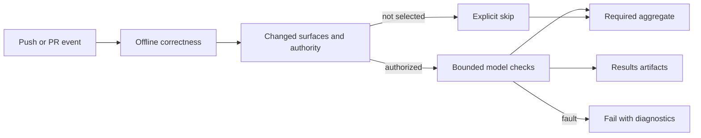

# CI: what runs and what to do when it fails

Start with the failed job on the exact PR head. A green aggregate can mean a
paid leg was intentionally skipped; it does not establish that a skill helps.
The [coverage reference](../docs/testing.md) owns the complete test inventory.



In text: run free checks first, select relevant paid work under the existing
authorization gate, then report pass, failure or skip and preserve its evidence.

| Event | Free checks | Model calls | Publication |
|---|---|---|---|
| Main-rooted PR, including native stack layers | Deterministic, install and selected counterfeit/scale checks | Reachability probes; behavioral, routing and deep subject legs require the existing same-repo `paid-evals` gate | None |
| Push to main | Same applicable checks | Changed-surface model legs can run automatically | Pages is a separate existing workflow |
| Scheduled gallery refresh | Selection, capture launch and the full cheap gate before spending; generated output checked afterward | Selected valid packs, existing cadence and providers | Review PR only; merge publishes Pages |
| Manual evaluation workflows | Workflow-specific checks | Some spend; inspect inputs and the coverage reference first | No permission implied by this table |

Do not add a paid label or dispatch a suite merely to obtain a green badge.
Record run IDs, successful calls, retries and available usage. A reported result
cost is not a billing receipt; absent token or cost data means unknown.

## Reproduce a free failure

From the repository root on qualified Ubuntu 24.04 with the pinned tools:

```sh
python3 -m unittest discover -s ci/tests -p 'test_*.py'
python3 ci/check_paid_scheduling.py --self-test
bash evals/cheap/run.sh
```

The first two commands need Python, Git and Bash and make no model calls. The
full cheap tier also needs the sandbox/toolchain described in
[testing](../docs/testing.md#cheap-tier). Windows source tests do not qualify
Linux sandbox behavior. Fix a source regression rather than weakening a gate;
compare an identical clean-main run before calling a failure pre-existing.

## Tool and profile ownership

[`setup-eval-tools`](../.github/actions/setup-eval-tools/action.yml) reads the
Node pin from `evals/redteam/pin.json`, installs the exact
[`tools/package-lock.json`](tools/package-lock.json) into runner temp with
general lifecycle scripts disabled, explicitly runs the inspected locked Claude
platform-copy installer, verifies its executable ELF binary without invoking the
CLI, and provisions the existing logger and, for offline jobs, bubblewrap adapters.
[`lifecycle-policy.json`](tools/lifecycle-policy.json) records every locked package
with an install script and the one approved invocation. New lifecycle entries
fail policy checks until reviewed. The security overrides pin patched
`simple-git` and its argument parser; the free Git API smoke checks read-only
operations and unsafe editor/trailer rejection without initializing Promptfoo.
Update the manifest, lock and applicable policy together. Never regenerate pins from
whatever happens to be installed locally.

[`eval-profile.sh`](eval-profile.sh) supplies fresh empty Promptfoo, Claude and
Codex profile directories. No personal profile or login is imported or cached.
Analytics/error-reporting opt-outs reduce traffic; pinned Promptfoo still
attempts a runtime/installation diagnostic when telemetry is disabled. They are
not a zero-network guarantee. Offline executions retain the existing wrapper's
fail-closed proxy and key isolation. Do not log secrets or upload profiles.

## Gallery refresh recovery

Read the [capture procedure](../evals/paid/README.md). A launch failure must be
caught by preflight before models run. Raw `promptfoo-results` artifacts survive
later failures. A missing pair is a skip for that plugin; zero captures fails
the refresh. Do not rerun the paid workflow to repair file modes or rendering.
Recover existing output only with its original source and honest provenance.

## Working in a PR stack

Use a linear chain: `main <- foundation <- next-layer`. Each PR targets the
previous branch and stays draft until reviewed. Native linkage is a separate
GitHub stack object, not merely matching branch bases.

For already pushed drafts, the official `gh stack link <pr-url> <pr-url>` links
them bottom to top without pushing branch arguments. Verify the remote stack,
heads, bases, draft state and individual diffs afterward. Each native layer
inherits trunk rules and Actions filters, so do not turn off intermediate free
checks to save time. See GitHub's [stack CLI reference](https://docs.github.com/en/pull-requests/reference/stacked-prs-cli-commands)
and [stack CI guidance](https://docs.github.com/en/pull-requests/how-tos/merge-and-close-pull-requests/optimizing-ci-for-stacked-pull-requests).

After an authorized merge, fetch and inspect GitHub's automatic retarget/rebase
before touching local branches. `sync` rebases and pushes; it is not a status
command. Some versions can report an aborted sync with exit zero. Inspect actual
state, reconcile partial pushes before retrying, and never force-rewrite shared
history without permission. Do not prune branches unless deletion is intended.

Opening and then linking a draft can emit both `opened` and `stacked` events.
The existing concurrency group cancels the superseded run. Check the surviving
exact-head run rather than rerunning a canceled one. Aggregates report a failed
cheap dependency as blocked; canceled runs do not fabricate a new verdict.
Keep `stacked` coverage: membership changes must inherit the trunk's checks.
