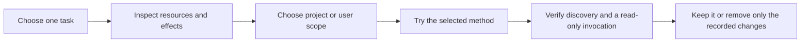

# Choose how to try a method

Start with [one read-only task](getting-started.md). Source loading needs no
plugin installation. If you want the method to stay available, choose a route
below or give your agent the [guided-install prompt](guided-installation.md).

Registering a marketplace, installing a package, enabling it, and invoking a
skill are separate actions. A successful install is not proof that hooks,
independent workers, or the method itself work in your host.

<!-- BEGIN INSTALLATION ROUTES -->
| Route | What changes | Evidence here |
|---|---|---|
| Explicit source load | Disposable clone and the current task | A read-only Codex search on Windows was exercised in Getting started |
| Claude session trial | Load one local plugin for one session | Host-documented; native loading was not exercised here |
| Codex project skill | Add the starter skill and LICENSE to the selected project's .agents/skills/ | Declared resource closure checked; discovery and invocation still need verification |
| Native marketplace | Marketplace registration, installed cache and host settings | Repository structure and official host guidance; no end-to-end native qualification |
| APM | Project manifest, lockfile and selected target files; lifecycle actions may also run | Host-documented; this repository's APM deployment was not exercised |
<!-- END INSTALLATION ROUTES -->

The table comes from [the support inventory](installation-routes.json), which
records source dates, package units, effects and qualification boundaries.



In text: choose a small task, inspect what loading or installation adds, select
its scope, then try it and verify discovery and use. Keep a removal receipt.

## A session trial

From a clone of this repository, with a Claude CLI whose help advertises
`--plugin-dir`:

```sh
claude --plugin-dir ./plugins/find-before-build
```

Ask it to apply `find-before-build` to the [read-only exercise](getting-started.md#2-give-it-a-concrete-task).
End that session to stop loading this copy. This does not uninstall an existing
copy; session and installed copies can have different precedence. See
[Claude's command reference](https://code.claude.com/docs/en/plugins/cli-reference).

## Keep one skill in a Codex project

Codex supports project-local `.agents/skills/`. For this starter only, the checked
copy consists of `plugins/find-before-build/skills/find-before-build/SKILL.md`
plus the repository `LICENSE`. Select the destination project explicitly,
preserve any existing directory, and record the full source commit. Use the
[guided prompt](guided-installation.md#codex-project-skill) for the copy and check.
See [Codex skill discovery](https://developers.openai.com/codex/skills).

To undo a manual project copy, inspect the recorded destination and compare its
files with the installation receipt. Remove only the new `SKILL.md`, `LICENSE`
and now-empty directory that receipt identifies; preserve edits and unrelated
content. Refresh or restart the host and check discovery again. Another installed
copy may still provide the same identifier, so inspect its source before acting.

This permission to copy the starter does not generalize to every skill.
`delegated-intelligence` loads `../../context/OPERATING.md` and local references;
copying its skill directory alone loses required resources. Use the repository
source route for advanced composition until its complete package and linked
capabilities have been checked. A related-method link is not automatically an
installed dependency.

## Use native marketplace packaging

For Claude, inspect `claude plugin install --help` and choose scope explicitly;
the CLI's default user scope is broader than a project trial. Prefer the session
route above for a first look. Native persistent installation and removal are
described in [Claude's plugin guide](https://code.claude.com/docs/en/discover-plugins).

For Codex, registration can use a full source commit:

```sh
codex plugin marketplace add JRichlen/agent-plugins --ref FULL_COMMIT_SHA
codex plugin marketplace list
```

These commands register a source, not install a plugin. In the ChatGPT desktop
app's Plugins Directory, select the marketplace and package, inspect its effects
and enable it in the intended scope. Check availability in your installed client;
this route has not been exercised here.

This repository keeps `.claude-plugin/plugin.json` as the edited source and
generates each package's root `plugin.json` (and `mcp.json` where needed) with
`ci/agent_plugins.py`. The portable format exposes skills and MCP servers;
Claude-specific commands and hooks need separate host support. OpenAI also
documents legacy `.claude-plugin/marketplace.json` discovery. Inspect the pinned
revision rather than assuming a filename guarantees loading. See
[OpenAI's packaging guide](https://developers.openai.com/plugins/build/plugins)
and the [portable adapter](../core/adapters/portable.md).

Disable or remove the installed plugin through the host, then verify discovery.
Removing marketplace registration is a separate operation; it does not prove
that installed copies or prior task effects have been removed. Before Claude
uninstallation or marketplace removal, inspect its data-removal warning and
preserve any plugin-owned data you need. Removal is broader than ending a trial.

## Use APM deliberately

Select one target explicitly on a fresh project. For a starter skill, inspect
the skill-subpath route and use `--only apm` to exclude MCP/LSP service
configuration. Keep the resulting manifest and lockfile. Frozen replay uses an
existing deployment lock with no positional package additions; do not use
`--force` to bypass a failed audit. See [APM install](https://microsoft.github.io/apm/reference/cli/install/).

Inspect lifecycle scripts before removal too. `apm uninstall --dry-run` can run
`pre-uninstall` scripts; it is not a side-effect-free preview. Preserve local
edits and inspect the exact removal set. See [APM uninstall](https://microsoft.github.io/apm/reference/cli/uninstall/).

## Check what actually worked

Record the host/version/OS, source SHA, selected unit, scope, changed paths,
discovered identifier and one harmless invocation. Distinguish structural checks
from installation and real use. Normal assistant turns may incur their usual
usage; this trial requires no separate paid evaluation.

Other hosts may support these formats, but require their own qualification.
The [portable adapter](../core/adapters/portable.md) explains the boundary.
Compiler MCP integration starts a Python process and has separate permissions;
it is not part of this instruction-only starter.

<details>
<summary>Considering another skill installer?</summary>

[Vercel's skills CLI](https://github.com/vercel-labs/skills) is another option.
Its current requirements include Node 22.20 or later, and its default behavior
includes telemetry and security-audit network requests. We have not qualified
that route here. Inspect its version, selected agent, scope and outbound data
before use; do not install every skill just because the CLI discovers it.
The same required-resource checks still apply.

</details>
