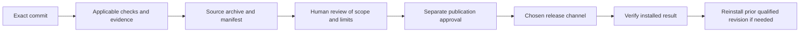

# Prepare a source candidate

This repository currently distributes plugins from Git. Candidate staging makes
that source inspectable and reproducible; it does **not** publish a GitHub
Release, tag, package registry entry or installation. No automatic release
promotion is configured.



In text: select immutable source, check it, package it, review it, then separately
authorize a publication channel and verify the installed result. The automated
workflow stops at the candidate. Later boxes are a maintainer procedure, not
shipped automation or permission to deploy.

## Build locally without running source code

Prerequisites: Python 3.12.3 and Git. From the repository root:

```sh
python3 -m unittest discover -s ci/tests -p 'test_release.py'
python3 release/build_candidate.py --revision FULL_COMMIT_SHA --output /tmp/plugin-candidate
cd /tmp/plugin-candidate
sha256sum -c SHA256SUMS
```

Use a nonexistent output directory; even an existing empty directory is refused. The builder reads Git objects, never the dirty
working tree, and does not execute the selected candidate. It writes a tar.gz,
`manifest.json` and `SHA256SUMS`. The manifest records the exact commit/tree,
every source file's Git blob, bytes, mode and SHA-256. Timestamps, ownership and
compression headers are fixed; executable bits and safe relative symlinks are
preserved. Unsupported submodules, escaping links and targets traversing any
committed symlink component fail closed; chained symlinks are conservatively
unsupported. Files are created exclusively, so dangling output links are not
followed.

The builder disables Git replacement objects and inherited Git environment/config
overrides, verifies blob identities, and rejects non-UTF-8 names and unsafe
`.git` path components. It writes into a private staging directory and publishes
the complete directory only after every output succeeds; failed builds leave no
partial candidate. The manifest separately identifies candidate source, builder
revision/source hash, Python, Git and zlib versions. These are reproducibility
inputs, not a signature.

Directory entries are implicit: Git tracks files and links, not directory modes
or empty directories. Normal tar extraction creates parent directories; this
archive does not promise to restore untracked filesystem metadata.

The archive is a source snapshot of the entire tracked tree, not a compiled or
independently signed product. Checksums detect changed bytes but do not prove
authenticity: obtain the candidate from the expected repository/run and compare
its commit against GitHub. Test reproducibility with the same Python/toolchain;
cross-version compressor equivalence has not been established.

## Stage in Actions

The [`release-candidate` workflow](../.github/workflows/release-candidate.yml)
runs free packaging tests on affected PRs. A maintainer may separately dispatch
it with a full commit SHA reachable from the checkout. Dispatch uploads a
30-day artifact with a read-only repository token. It makes no model calls and
has no release-write permission. A successful candidate job is not a statement
that every behavioral or host check passed.

Before any actual release, inspect the exact commit's checks and skipped legs,
unresolved failures, compatibility changes, version policy and known host limits.
Agree the publication channel/version and undo target. No repository-wide
version/tag policy is yet established; do not infer one from this archive name.
Publication and deployment still need explicit authority.

| Failure or uncertainty | Next action |
|---|---|
| Missing commit | Fetch the intended source and verify its full SHA; never substitute current main silently |
| Existing output | Choose a new directory; the builder refuses overwrite |
| Checksum mismatch | Discard the candidate and retrieve/build from the verified commit |
| Unsupported Git entry | Review packaging support; do not silently omit the file |
| Red or skipped behavioral check | Report the actual limit; packaging success does not override it |
| Installation regression | Stop adoption and restore the previous qualified revision using that host's supported removal/install path |

Keep the previous revision and its evidence available through Git and the review
process. Do not maintain a second narrative archive. Host-specific installation
and removal commands belong in the user guide for that host, not this builder.
